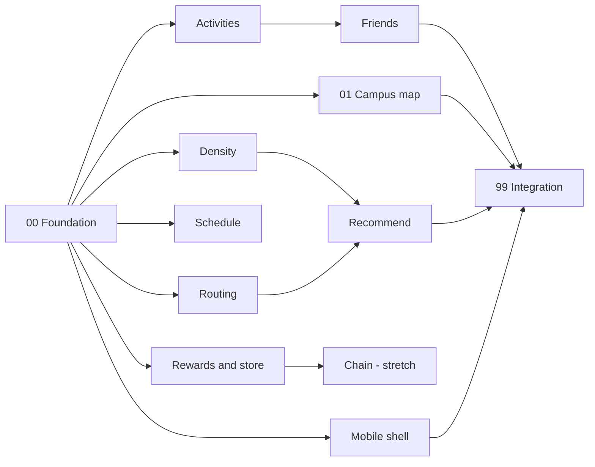

# ZooMap build plan

ZooMap is a campus app for UMass Amherst: a 3D campus map with a live people-density heatmap, walking routes, the user's class schedule, hosted activities, and points for time spent at activities that can be spent in a store. Built for a hackathon demo in 24 to 48 hours.

Read this file, then [contracts.md](contracts.md), then your own brief. Briefs are self-contained beyond those two.

## Decisions (made with the project owner on 2026-11-14)

| Topic | Decision |
|---|---|
| Scope | Hackathon demo, 24-48 h. Demo-grade shortcuts are fine where a brief says so. |
| Platform | One Next.js web app. An Android app shell (Capacitor) wraps the deployed site and adds background location. The same site runs in any browser with foreground-only location. iPhone = browser only. |
| Language | TypeScript everywhere, one package, npm. |
| Density data | Opt-in user location plus a simulated source. Simulated data is always labelled in the API and the UI. |
| Sign-in | Google sign-in restricted to `umass.edu`, enforced on the server. |
| Schedule | Google Calendar (official connection) and Canvas calendar feed link. |
| Routing | Outdoor walking only, computed by ZooMap from OpenStreetMap footpaths. |
| Points | Earned per minute of location-verified time at an activity. MongoDB ledger is the source of truth. |
| Store | Mock catalog; redeeming deducts points and issues a claim code. |
| Solana | Optional mirror of the ledger to a devnet token. Stretch. Never on the path of a points operation. |
| AI | Gemini picks a study spot from candidates the server pre-computes. |
| Database | MongoDB Atlas. |
| Hosting | Vercel (serverless: no background jobs, no websockets). Clients poll. |

Defaults chosen by the planner, veto freely: Vercel hosting; npm; Auth.js for sign-in; the map drawn only from ZooMap's own OpenStreetMap extract, with no outside map tiles; heatmap polling every 10 seconds; a user can be in one activity at a time and hosting counts as being in it; time counts within 150 m of the activity's building; 1 point per minute, capped at 240 per activity and 600 per day; Solana addresses created and held by the server.

## Stack (versions checked on npm 2026-11-14)

| Package | Version | Used for |
|---|---|---|
| next | 16.4.6 | App Router, route handlers |
| react | 19.3.1 | UI |
| maplibre-gl | 6.18.0 | 3D map, used directly (no React wrapper) |
| next-auth | 5.0.0-beta.32 | Google sign-in, JWT sessions |
| mongodb | 7.9.0 | Native driver, no ODM |
| zod | 4.6.7 | Contracts and request validation |
| h3-js | 4.5.0 | Location cells |
| @google/genai | 3.3.0 | Gemini |
| node-ical | 0.27.6 | Calendar feed parsing |
| tailwindcss | 4.3.5 | Styling |
| vitest | 5.1.0 | Tests |
| tsx | 4.23.15 | Scripts |
| osmtogeojson | 3.0.0-beta.5 | OSM conversion in the build script only |
| @capacitor/core, cli, android | 8.6.2 | Android shell |

Several of these are newer than an agent's training data may cover (Next 16, MapLibre 6, zod 4, Auth.js v5). **Check current docs before writing framework code.**

Gemini model: `gemini-3.8-flash` was listed as stable on ai.google.dev on 2026-11-14. It is read from `GEMINI_MODEL`; confirm on the models page before the demo.

## Architecture

```
src/
  app/                 routes only: pages and thin API handlers
  modules/<feature>/   all feature code: service, repo, ui/, subscribers.ts, seed.ts, index.ts
  shared/              contracts, db, events, http, ui, platform   (frozen after Phase 0)
scripts/               build-campus.ts, db-setup.ts
data/campus/           generated map data, committed
android/               Capacitor shell
```

Four seams make new features cheap. Each is defined in Phase 0 and described in [contracts.md](contracts.md):

1. **Module boundary.** A feature lives in `src/modules/<feature>/`. Other code imports only its `index.ts`.
2. **Domain events.** Modules announce facts (`participation.ended`) on an in-process bus. Others subscribe. Rewards never imports activities.
3. **Registries.** Map layers, panels, density sources, schedule providers and reward rules are arrays of plug-ins. Adding one is a new file plus one line.
4. **Contracts.** Zod schemas in `src/shared/contracts/` are the single definition of every API shape and stored document.

To add a feature later: create `src/modules/<name>/`, add routes under `src/app/api/<name>/`, register its panel or layer, subscribe to the events it needs.

## Phases and workstreams



| Order | Brief | Runs | Needs a human |
|---|---|---|---|
| 0 | [00-foundation.md](00-foundation.md) | Alone | Atlas URI, Google OAuth client |
| 1 | [01-campus-map.md](01-campus-map.md) | Parallel; its build script may start early, at the `scaffold-checkpoint` tag | No |
| 2 | [ws-density.md](ws-density.md) | Parallel | No |
| 2 | [ws-activities.md](ws-activities.md) | Parallel | No |
| 2 | [ws-routing.md](ws-routing.md) | Parallel | No |
| 2 | [ws-mobile.md](ws-mobile.md) | Parallel | Android Studio, a phone |
| 2 | [ws-rewards.md](ws-rewards.md) | Parallel | No |
| 2 | [ws-schedule.md](ws-schedule.md) | Parallel | Calendar test with a UMass account |
| 3 | [ws-recommend.md](ws-recommend.md) | After density and routing merge | Gemini key |
| 3 | [ws-chain.md](ws-chain.md) | Stretch, after rewards merges | No |
| 3 | [ws-friends.md](ws-friends.md) | After activities merges (done); needs a registry line and a QR-library yes | QR scan test on two phones |
| 4 | [99-integration.md](99-integration.md) | Alone, last | Demo rehearsal |

Rows 1 and 2 all start when Foundation merges, in the priority order shown. With four sessions, start campus map, density, activities and routing. Each builds against Foundation's stubs and fixture campus, so none waits for another.

**Cut order if behind:** chain, then Google Calendar (keep the feed link), then background tracking (fall back to foreground location in the browser), then Gemini (the deterministic fallback already answers).

## Risks

1. **UMass may block outside apps on student Google accounts.** Unverifiable without a UMass account. A human tests sign-in on the Phase 0 build before wave 2 starts. If sign-in is blocked, stop and ask the owner. If only calendar access is blocked, Google Calendar's "secret address in iCal format" works through the feed-link provider.
2. **Google refuses sign-in inside an Android WebView.** The shell signs in through the system browser and hands the session back. See ws-mobile.
3. **Android throttles WebView network calls in the background.** Background pings go through native HTTP with a device token. See ws-mobile.
4. **Empty heatmap.** Few live users at a hackathon. The simulated source carries the demo.
5. **Live counts of 1 reveal a person.** `DENSITY_MIN_LIVE_COUNT` is 1 for the demo and must be 3 or more for any real launch.
6. **A failed points award is logged, not retried.** Acceptable for the demo.
7. **No agreement with the UMass store, no legal review of rewards.** Mock only. Solana stays on devnet.

## Human setup checklist

Only the owner can do these. Foundation needs 1 and 2.

1. MongoDB Atlas: free cluster, database user, network access `0.0.0.0/0`, copy the connection string.
2. Google Cloud: new project; consent screen "External", status "Testing"; add every teammate's `umass.edu` address as a test user; enable the Google Calendar API; create a Web OAuth client with redirect URIs `/api/auth/callback/google` and `/api/schedule/google/callback` on both `http://localhost:3000` and the Vercel URL.
3. Gemini API key from Google AI Studio.
4. GitHub repository and a Vercel project connected to it, with the env vars from contracts.md.
5. Android Studio with the SDK, and an Android phone with USB debugging on.
6. Sign in to the Phase 0 build with a real `umass.edu` account (risk 1).

## Demo script

Integration rehearses exactly this:

1. Sign in with a `umass.edu` Google account; another domain is refused.
2. The 3D campus shows the heatmap, with simulated data labelled.
3. Ask for a quiet study spot; Gemini's pick is explained and the route is drawn.
4. The schedule shows the next class with a "leave by" time and a route.
5. Phone A hosts an activity; hosting a second one is refused. Phone B joins.
6. With the app in the background, verified minutes and pending points grow.
7. Phone B leaves; the points land in its balance.
8. Redeem a store item; the balance drops and a claim code appears.
9. Stretch: open the devnet token account in a Solana explorer.
